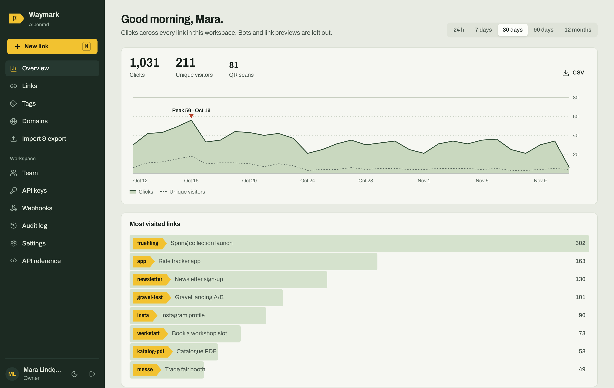

# Waymark

[English](README.md) · **Deutsch**

**Ein privater Link-Kürzer zum Selbsthosten: eine vollwertige Short.io-Alternative, die dir gehört.**
Eigene Domains, Weiterleitung nach Land und Gerät, A/B-Tests, Passwort- und Ablaufregeln, QR-Codes, datensparsame Statistiken, ein Team mit Rollen, API-Keys mit Berechtigungen und signierte Webhooks. Läuft kostenlos auf Cloudflare Workers + D1 oder überall, wo Docker oder Node läuft, mit einer SQLite-Datei.



Niemand kann sich selbst registrieren. Der Owner legt das erste Konto an und lädt alle anderen ein. Links entstehen in der App, über die API oder per Import. Öffentliches Kürzen schaltest du nur ein, wenn du es willst.

Die Oberfläche gibt es auf Deutsch und Englisch. Sie richtet sich nach der Browsersprache und lässt sich unten in der Seitenleiste umschalten (DE/EN). Auch die Seiten, die Besucher sehen (Passwortabfrage, abgelaufen, nicht gefunden), erscheinen auf Deutsch, wenn der Browser Deutsch bevorzugt.

## Inhalt

- [Funktionen](#funktionen)
- [Welcher kostenlose Hoster?](#welcher-kostenlose-hoster)
- [Installation](#installation)
- [Konfiguration](#konfiguration)
- [Umzug von Short.io, Bitly & Co.](#umzug-von-shortio-bitly--co)
- [API](#api)
- [Datenschutz & Sicherheit](#datenschutz--sicherheit)
- [Entwicklung](#entwicklung)

## Funktionen

| | Waymark |
|---|---|
| **Links** | Eigene oder zufällige Kürzel (Länge pro Domain), Kürzel mit Pfad (`/sommer/2026`), Umlaute, Groß-/Kleinschreibung pro Domain, Titel, Notizen, farbige Tags, Archiv, Sammelaktionen, Suche, Filter, Sortierung |
| **Domains** | Beliebig viele eigene Domains, eine Standard-Domain, Weiterleitung für Startseite und unbekannte Kürzel pro Domain |
| **Weiterleitung** | Regeln nach Land, Gerät, Betriebssystem und Sprache (erste passende gewinnt), „App-Store-Paar“ mit einem Klick, A/B-Tests mit Gewichtung, Query-Parameter durchreichen, UTM-Builder, 301/302/307/308 pro Link oder global, Cloaking (Kurz-URL bleibt in der Adressleiste) |
| **Zugriff** | Passwortgeschützte Links, Startdatum, Ablaufdatum, Klicklimit, Ersatz-URL nach Ablauf |
| **Social-Vorschau** | Eigener Open-Graph-Titel, Beschreibung und Bild für Slack, WhatsApp, X, LinkedIn, Discord, Telegram und andere |
| **QR-Codes** | SVG und PNG, Farbvorlagen oder eigene Farben, Scans werden getrennt gezählt |
| **Statistik** | Klicks und eindeutige Besucher im Zeitverlauf mit markierter Spitze, Länder, Städte, Herkunft, Geräte, Systeme, Browser, Sprachen, Tageszeit, genommene Regel oder Variante, QR-Scans, Bot-Filter, CSV-Export, einstellbare Aufbewahrung |
| **Team** | Rollen Owner, Admin, Editor, Betrachter; Einladungslinks; Links zum Zurücksetzen des Passworts; Konten deaktivieren oder entfernen; angemeldete Geräte pro Konto |
| **API** | Alles, was die App kann, auch per HTTP; API-Keys mit Berechtigungen, optionaler Domain-Beschränkung und Ablaufdatum; ein Key kann nie mehr als die Rolle seiner Erstellerin oder seines Erstellers; optional CORS; Wiederverwendung statt Duplikaten |
| **Webhooks** | `link.created`, `link.updated`, `link.deleted`, `link.clicked`, HMAC-SHA256-signiert, Test-Button, automatische Pause nach wiederholten Fehlern |
| **Import / Export** | Direkter Short.io-Import über deren API, CSV-Import mit automatischer Spaltenzuordnung (Short.io, Bitly, Rebrandly, YOURLS, Kutt, Dub, Tabellen), Klickzahlen bleiben erhalten, vollständige JSON-Sicherung und Wiederherstellung, CSV-Export |
| **Betrieb** | Protokoll (Audit-Log), Prüfung des Link-Ziels, helles und dunkles Design, Tastenkürzel (`N` neuer Link, `/` Suche), Handy-Ansicht, Migrationen laufen automatisch |
| **Öffentlich (optional)** | Anonymes `POST /api/v1/public/shorten`, pro IP begrenzt, standardmäßig aus |

## Welcher kostenlose Hoster?

Waymark ist eine Codebasis mit drei Speicher-Adaptern (Cloudflare D1, lokale SQLite-Datei, Turso/libSQL). Du kannst also auf einem Hoster anfangen und mit der Sicherungsdatei umziehen.

| Hoster | Kostenlose Aufrufe | Datenbank | Gut für |
|---|---|---|---|
| **Cloudflare Workers + D1** | 100.000 pro Tag (≈ 3 Mio. pro Monat). Die Admin-Oberfläche ist statisch und zählt nicht mit. | D1: 5 Mio. gelesene und 100.000 geschriebene Zeilen pro Tag, 5 GB | Einstieg: kein Server, weltweit, eigene Domains mit automatischem HTTPS |
| **Eigener Server mit Docker** (Oracle Cloud „Always Free“, Raspberry Pi mit Cloudflare Tunnel, VPS für ca. 4 €) | **Kein Limit** außer der Hardware | SQLite-Datei | Echte Unabhängigkeit, viel Traffic |
| Vercel Hobby | 1 Mio. Aufrufe pro Monat, nur nicht-kommerziell | braucht Turso | Mit dem Node-Einstieg möglich, nicht empfohlen |
| Deno Deploy Free | ≈ 1 Mio. Aufrufe pro Monat | braucht Turso | Möglich, nicht fertig verpackt |
| Render / Koyeb (kostenlose Web-Services) | schlafen bei Leerlauf, keine dauerhafte Festplatte | braucht Turso | Hobby-Nutzung |
| Turso Free (nur Datenbank) | 500 Mio. gelesene, 10 Mio. geschriebene Zeilen pro Monat | libSQL | Datenbank für Hoster ohne Festplatte |

Was das im kostenlosen Cloudflare-Tarif praktisch bedeutet:

- **Weiterleitungen** funktionieren bis 100.000 Aufrufe pro Tag.
- **Klickzählung** schreibt etwa fünf Zeilen pro Klick (der Klick, zwei Index-Einträge, die ID-Sequenz, der Zähler am Link). Das reicht für rund **20.000 gezählte Klicks pro Tag**. Ist das tägliche Schreib-Budget aufgebraucht, leiten die Links weiter, nur die Statistik pausiert bis Mitternacht (UTC).
- **Dashboards** lesen die Klicks des gewählten Zeitraums einmal pro Aufschlüsselung. Bei Hunderttausenden Klicks in einem Zeitraum kann schon ein Aufruf einen großen Teil der 5 Mio. täglichen Lesezugriffe verbrauchen. Wähle kürzere Zeiträume, verkürze die Aufbewahrung in den Einstellungen oder wechsle auf Docker.
- Wenn es zu eng wird: Workers Paid kostet 5 $ pro Monat (10 Mio. Aufrufe, 50 Mio. D1-Schreibzugriffe), oder du betreibst das Docker-Image auf eigener Hardware. Gleiche App, gleiche Sicherungsdatei.

Stand der Limits: November 2026. Prüfe vorher die Seiten der Anbieter, die Zahlen ändern sich.

## Installation

### 1. Cloudflare Workers + D1 (empfohlen)

[](https://deploy.workers.cloudflare.com/?url=https://github.com/einfachruwen/waymark)

Der Button kopiert das Repository in dein GitHub-Konto, legt die D1-Datenbank an und deployt. Danach `https://<dein-worker>.workers.dev/_/` öffnen und das Owner-Konto anlegen.

Von Hand:

```bash
git clone https://github.com/einfachruwen/waymark && cd waymark
npm install
npx wrangler login
npx wrangler secret put SETUP_TOKEN   # optional, schützt die Einrichtungsseite
npm run deploy                         # baut die Oberfläche, legt D1 an, deployt
```

Falls deine Wrangler-Version die Datenbank nicht selbst anlegt: `npx wrangler d1 create waymark` ausführen und die ausgegebene `database_id` in `wrangler.jsonc` eintragen.

**Eigene Domain:** Cloudflare-Dashboard → Workers & Pages → waymark → Settings → Domains & Routes → Add → Custom domain. Danach denselben Hostnamen in Waymark unter **Domains** hinzufügen. Die Tabellen entstehen beim ersten Aufruf, ein Migrationsschritt ist nicht nötig.

### 2. Docker (ohne Limits, auf deinem Server)

```bash
docker run -d --name waymark -p 8787:8787 -v waymark-data:/data \
  -e SETUP_TOKEN=change-me ghcr.io/einfachruwen/waymark:latest
```

oder mit der mitgelieferten [`docker-compose.yml`](docker-compose.yml): `docker compose up -d`. Dann `http://localhost:8787/_/` öffnen.

Davor gehört ein Reverse Proxy mit HTTPS, zum Beispiel Caddy:

```
go.example.com {
  reverse_proxy localhost:8787
}
```

Hinter Cloudflare (Proxy oder Tunnel) liest Waymark das Land der Besucher automatisch aus dem Header `CF-IPCountry`. Sichern kannst du durch Kopieren des Volumes `/data` oder über **Import & Export → Sicherung**.

### 3. Node ohne Docker, oder ein PaaS mit Turso

Braucht Node 22.13 oder neuer.

```bash
npm install && npm run build
DATABASE_PATH=./data/waymark.db npm start
```

Auf Hostern ohne dauerhafte Festplatte nutzt du [Turso](https://turso.tech):

```bash
DATABASE_URL=libsql://deine-db.turso.io DATABASE_AUTH_TOKEN=… npm start
```

### Updates

Kopien über den Button **Deploy to Cloudflare** sind eigenständige Repositories, keine Forks. Neue Versionen kommen dort also nicht von selbst an. Jede Kopie enthält deshalb den Workflow [`.github/workflows/update.yml`](.github/workflows/update.yml): Er holt einmal täglich die neueste Waymark-Version in dein Repository, und Cloudflare deployt den neuen Commit.

- **Sofort aktualisieren:** dein Repository → Actions → *Update Waymark* → Run workflow.
- **Kopie von vor dem 11. November 2026?** Dann fehlt der Workflow noch. Einmal hinzufügen: im Repository Add file → Create new file, Name `.github/workflows/update.yml`, den [Inhalt dieser Datei](https://raw.githubusercontent.com/EinfachRuwen/waymark/main/.github/workflows/update.yml) einfügen und committen.
- **Bleibt beim Update erhalten:** `wrangler.jsonc` (deine Datenbank-Anbindung) und alles in `.github/workflows`. Andere Dateien werden durch die neue Version ersetzt. Wenn du weitere behalten willst, lege eine Repository-Variable `WAYMARK_KEEP` mit Pfaden an, getrennt durch Leerzeichen.
- **Auch Workflow-Dateien aktualisieren:** Secret `WAYMARK_UPDATE_TOKEN` anlegen, ein Fine-grained Token für dieses Repository mit Schreibrecht für *Contents* und *Workflows*. Ohne Token darf der Standard-Token keine Workflow-Dateien ändern.
- Cloudflare deployt bei jedem Push auf den Standard-Branch, wenn der Worker mit dem Repository verbunden ist (Worker → Settings → Builds). Der Button richtet das ein.
- GitHub pausiert geplante Workflows nach 60 Tagen ohne Aktivität im Repository. Dann einmal von Hand starten.
- Docker: `docker compose pull && docker compose up -d`.

## Konfiguration

Fast alles stellst du in der App unter **Einstellungen** ein. Umgebungsvariablen:

| Variable | Wo | Bedeutung |
|---|---|---|
| `SETUP_TOKEN` | überall | Wenn gesetzt, fragt die Ersteinrichtung danach. Für öffentliche URLs dringend empfohlen. |
| `PORT` | Node | Port, Standard `8787` |
| `HOST` | Node | Bind-Adresse, Standard `0.0.0.0` |
| `DATABASE_PATH` | Node | SQLite-Datei, Standard `./data/waymark.db` |
| `DATABASE_URL`, `DATABASE_AUTH_TOKEN` | Node | Turso/libSQL statt einer Datei |
| `TRUST_PROXY` | Node | `1` (Standard) vertraut `X-Forwarded-For`/`CF-Connecting-IP`. Auf `0` setzen, wenn Waymark direkt im Netz hängt. |
| `STATIC_DIR` | Node | Ort der gebauten Oberfläche, Standard `dist/client` |

## Umzug von Short.io, Bitly & Co.

**Short.io:** Import & Export → Aus Short.io, einen geheimen API-Key einfügen, Domain wählen. Waymark übernimmt seitenweise Ziele, Kürzel, Titel, Tags, Ablauf, Klicklimits, Cloaking, Weiterleitungstypen, UTM-Werte und iOS-/Android-URLs. Passwörter und Geo-Regeln gibt die Links-API von Short.io nicht heraus; die trägst du danach neu ein.

**Alles andere:** CSV exportieren und auf Import & Export → Aus CSV ziehen. Die Spalten werden automatisch zugeordnet, die Zuordnung lässt sich anpassen. Klickzahlen können übernommen werden.

Eine Domain umziehen, ohne Links zu brechen: unter Domains hinzufügen, hinein importieren, über den Waymark-Hostnamen testen, dann das DNS umstellen.

## API

Unter **API-Keys** einen Key erstellen, dann:

```bash
curl -X POST https://go.example.com/api/v1/links \
  -H "Authorization: Bearer wm_…" \
  -H "Content-Type: application/json" \
  -d '{"url":"https://example.com/launch","slug":"launch","tags":["kampagne"]}'
```

Die vollständige Referenz steht in der App unter **API-Referenz** und in [docs/API.md](docs/API.md) (Englisch).

## Datenschutz & Sicherheit

- Es werden keine IP-Adressen gespeichert. Eindeutige Besucher werden über einen gesalzenen Hash gezählt, der täglich wechselt.
- Bots, Crawler und Link-Vorschauen werden erkannt und standardmäßig aus der Statistik herausgehalten.
- Passwörter mit PBKDF2-SHA256; Sitzungen als HttpOnly-/SameSite-Cookies; Schreibzugriffe mit Cookie brauchen einen eigenen Header (CSRF-Schutz); API-Keys werden nur als SHA-256-Hash gespeichert und einmal angezeigt.
- Anmeldeversuche sind pro IP und Konto begrenzt. Die Oberfläche sendet eine strenge Content-Security-Policy und lässt sich nicht einbetten.
- Ziele mit `javascript:`, `data:` und ähnlichen Schemata werden abgelehnt.
- Keine Anfragen an Dritte: Schriften werden selbst ausgeliefert, es gibt keine Tracker. Das ist auch für die DSGVO relevant.

## Entwicklung

```bash
npm install
npm run dev          # API auf :8787 und die Oberfläche mit Hot Reload auf :5173/_/
npm run dev:worker   # echte Workers-Umgebung mit lokaler D1
npm test             # API- und Unit-Tests
npm run typecheck
DATABASE_PATH=./data/waymark.db npx tsx scripts/seed-demo.ts   # Demodaten
```

Aufbau: `src/server` (Hono-App, Weiterleitung, API-Routen, Speicher-Adapter, Einstiege für Workers und Node), `src/web` (React-Oberfläche, Übersetzungen in `src/web/lib/i18n-de.ts`), `src/shared` (Berechtigungen und API-Referenz für beide). Design-Entscheidungen stehen in [docs/DESIGN.md](docs/DESIGN.md).

**Neue Texte übersetzen:** Englischen Text in `t("…")` setzen und die deutsche Fassung mit dem englischen Text als Schlüssel in `src/web/lib/i18n-de.ts` eintragen. Fehlt ein Eintrag, erscheint der englische Text.

## Lizenz

MIT. Archivo und JetBrains Mono stehen unter der SIL Open Font License (siehe `src/web/public/fonts`).
