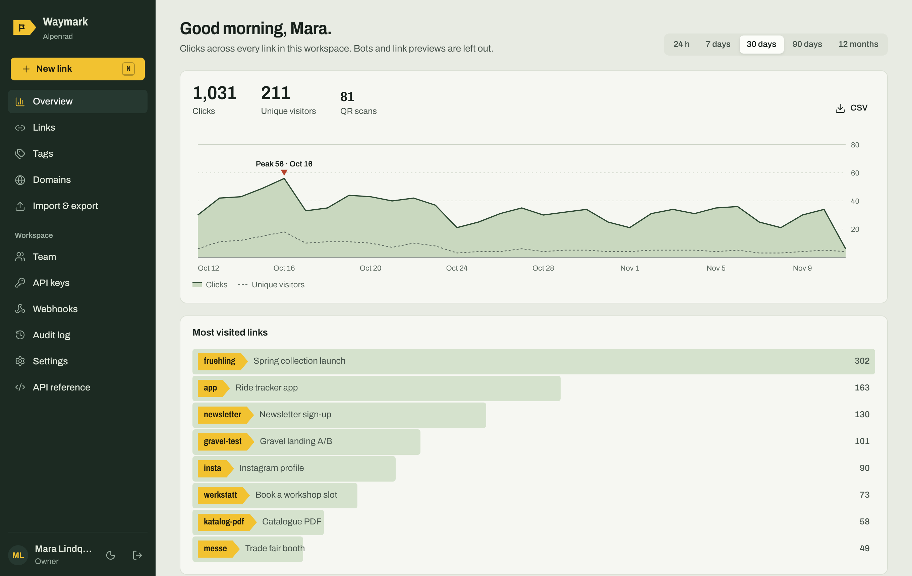
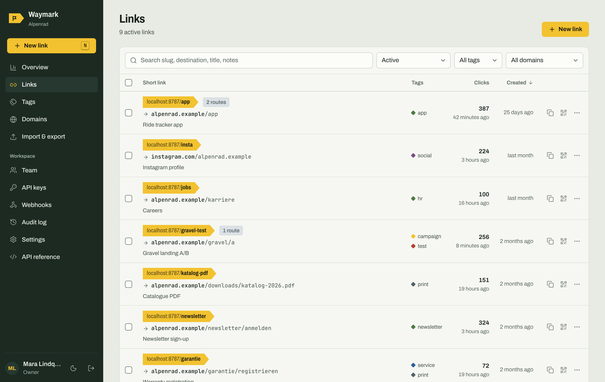
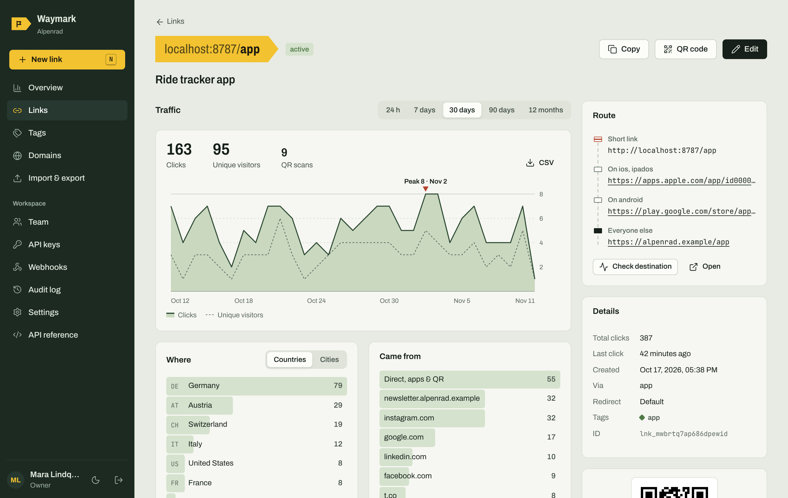
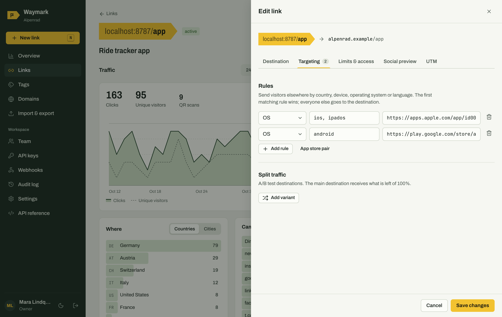
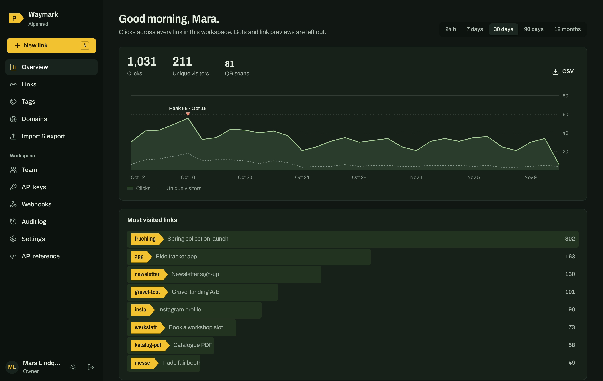

# Waymark

**English** · [Deutsch](README.de.md)

**A private, self-hosted link shortener: a full Short.io alternative you own.**
Branded short links, geo and device targeting, A/B splits, password and expiry rules, QR codes, privacy-friendly analytics, a team with roles, scoped API keys and signed webhooks. It runs for free on Cloudflare Workers + D1, or anywhere Docker or Node runs, with a SQLite file.



Nobody can sign up. The owner creates the first account and invites everyone else. Links come from the app, the API or imports. Turn on public shortening only if you want it.

<table>
<tr>
<td></td>
<td></td>
</tr>
<tr>
<td></td>
<td></td>
</tr>
</table>

## Contents

- [Features](#features)
- [Which free host?](#which-free-host)
- [Install](#install)
  - [Cloudflare Workers + D1 (recommended)](#1-cloudflare-workers--d1-recommended)
  - [Docker](#2-docker-unlimited-on-your-own-server)
  - [Node without Docker / Turso](#3-node-without-docker-or-a-paas-with-turso)
- [Configuration](#configuration)
- [Moving from Short.io, Bitly & co.](#moving-from-shortio-bitly--co)
- [API](#api)
- [Privacy & security](#privacy--security)
- [Development](#development)
- [Auf Deutsch](#auf-deutsch)

## Features

| | Waymark |
|---|---|
| **Links** | Custom or random slugs (length per domain), slugs with paths (`/summer/2026`), Unicode, case-sensitive or not per domain, titles, notes, tags with colors, archive, bulk actions, search, filters, sort |
| **Domains** | Any number of branded domains, a default domain, root redirect and not-found redirect per domain |
| **Routing** | Rules by country, device, OS and language (first match wins), "App store pair" in one click, A/B split testing with weights, query parameter pass-through, UTM builder, 301/302/307/308 per link or globally, cloaking (URL stays in the address bar) |
| **Access** | Password-protected links, start date, expiry date, click limit, a fallback URL after expiry |
| **Social previews** | Custom Open Graph title, description and image served to Slack, WhatsApp, X, LinkedIn, Discord, Telegram and others |
| **QR codes** | SVG and PNG, color presets or custom colors, scans counted separately |
| **Analytics** | Clicks and unique visitors over time, peak marker, countries, cities, referrers, devices, OS, browsers, languages, time of day, which rule or variant was taken, QR scans, bot filtering, CSV export, configurable retention |
| **Team** | Owner, admin, editor, viewer roles; invite links; password reset links; disable or remove people; signed-in devices per account |
| **API** | Every app action over HTTP; API keys with scopes, optional domain restriction and expiry; a key never exceeds its creator's role; optional CORS; reuse mode to avoid duplicates |
| **Webhooks** | `link.created`, `link.updated`, `link.deleted`, `link.clicked`, HMAC-SHA256 signed, test button, auto-pause after repeated failures |
| **Import / export** | Direct Short.io import via their API, CSV import with automatic column matching (Short.io, Bitly, Rebrandly, YOURLS, Kutt, Dub, spreadsheets), click totals kept, full JSON backup and restore, CSV export |
| **Languages** | English and German UI and visitor pages, picked from the browser, switchable in the sidebar |
| **Operations** | Audit log, link health check, light and dark theme, keyboard shortcuts (`N` new link, `/` search), mobile layout, migrations run automatically |
| **Public mode (optional)** | Anonymous `POST /api/v1/public/shorten`, rate-limited per IP, off by default |

## Which free host?

Waymark is one codebase with three storage adapters (Cloudflare D1, a local SQLite file, Turso/libSQL), so you can start on one host and move to another with the backup file.

| Host | Free requests | Database | Good for |
|---|---|---|---|
| **Cloudflare Workers + D1** | 100,000 per day (≈ 3 M per month). The admin UI is static and does not count. | D1: 5 M rows read and 100k rows written per day, 5 GB | Start here: no server, global, custom domains with automatic HTTPS |
| **Your own server with Docker** (Oracle Cloud Always Free, a Raspberry Pi with Cloudflare Tunnel, a €4 VPS) | **No limit** besides hardware | SQLite file on disk | Real independence; high traffic |
| Vercel Hobby | 1 M invocations per month, non-commercial use only | needs Turso | Possible with the Node entry, not recommended |
| Deno Deploy Free | ≈ 1 M requests per month | needs Turso | Possible, not packaged |
| Render / Koyeb free web services | sleep when idle, no persistent disk | needs Turso | Hobby use |
| Turso Free (database only) | 500 M rows read, 10 M rows written per month | libSQL | Database for hosts without a disk |

What this means in practice on the Cloudflare free plan:

- **Redirects** keep working up to 100,000 requests per day.
- **Click logging** writes about five rows per click (the click, its two index entries, the ID sequence, the link counter). That allows roughly **20,000 recorded clicks per day**. If the daily write budget runs out, redirects continue and only logging pauses until midnight UTC.
- **Dashboards** read the click rows of the selected period once per breakdown. With hundreds of thousands of clicks in a range, a single dashboard view can use a large share of the 5 M daily reads. Pick shorter ranges, reduce the retention under Settings, or move to Docker.
- When you outgrow it: Workers Paid costs $5 per month (10 M requests, 50 M D1 writes), or run the Docker image on hardware you control. Same app, same backup file.

Limits as of November 2026. Check the providers' pages before you rely on them; they change.

## Install

### 1. Cloudflare Workers + D1 (recommended)

[](https://deploy.workers.cloudflare.com/?url=https://github.com/einfachruwen/waymark)

The button forks the repository into your GitHub account, creates the D1 database and deploys. Then open `https://<your-worker>.workers.dev/_/` and create the owner account.

Manually:

```bash
git clone https://github.com/einfachruwen/waymark && cd waymark
npm install
npx wrangler login
npx wrangler secret put SETUP_TOKEN   # optional, protects the setup screen
npm run deploy                         # builds the admin UI, creates D1, deploys
```

If your Wrangler version does not create the database on its own, run `npx wrangler d1 create waymark` and paste the printed `database_id` into `wrangler.jsonc`.

**Custom domain:** Cloudflare dashboard → Workers & Pages → waymark → Settings → Domains & Routes → Add → Custom domain. Then add the same hostname under **Domains** in Waymark. Tables are created on the first request; there is no migration step.

### 2. Docker (unlimited, on your own server)

```bash
docker run -d --name waymark -p 8787:8787 -v waymark-data:/data \
  -e SETUP_TOKEN=change-me ghcr.io/einfachruwen/waymark:latest
```

or with the included [`docker-compose.yml`](docker-compose.yml): `docker compose up -d`. Open `http://localhost:8787/_/`.

Put a reverse proxy with HTTPS in front, for example Caddy:

```
go.example.com {
  reverse_proxy localhost:8787
}
```

Behind Cloudflare (proxy or Tunnel), Waymark reads the visitor country from the `CF-IPCountry` header automatically. Back up by copying the `/data` volume or with **Import & export → Backup**.

### 3. Node without Docker, or a PaaS with Turso

Needs Node 22.13 or newer.

```bash
npm install && npm run build
DATABASE_PATH=./data/waymark.db npm start
```

On hosts without a persistent disk, use [Turso](https://turso.tech):

```bash
DATABASE_URL=libsql://your-db.turso.io DATABASE_AUTH_TOKEN=… npm start
```

## Configuration

Almost everything is set in the app under **Settings**. Environment variables:

| Variable | Where | Meaning |
|---|---|---|
| `SETUP_TOKEN` | all | If set, the first-run setup asks for it. Strongly recommended for public URLs. |
| `PORT` | Node | Port, default `8787` |
| `HOST` | Node | Bind address, default `0.0.0.0` |
| `DATABASE_PATH` | Node | SQLite file, default `./data/waymark.db` |
| `DATABASE_URL`, `DATABASE_AUTH_TOKEN` | Node | Use Turso/libSQL instead of a file |
| `TRUST_PROXY` | Node | `1` (default) trusts `X-Forwarded-For`/`CF-Connecting-IP`. Set `0` when exposed directly. |
| `STATIC_DIR` | Node | Location of the built admin UI, default `dist/client` |

## Moving from Short.io, Bitly & co.

**Short.io:** Import & export → From Short.io, paste a secret API key, pick the domain. Waymark copies destinations, slugs, titles, tags, expiry, click limits, cloaking, redirect types, UTM values and iOS/Android URLs, page by page. Short.io does not expose passwords or its geo rules through the links API; set those again afterwards.

**Everything else:** export a CSV and drop it on Import & export → From CSV. Columns are matched automatically and you can adjust the mapping. Click totals can be kept.

To move a domain without breaking links: add it under Domains, import into it, test on the Waymark hostname, then switch DNS.

## API

Create a key under **API keys**, then:

```bash
curl -X POST https://go.example.com/api/v1/links \
  -H "Authorization: Bearer wm_…" \
  -H "Content-Type: application/json" \
  -d '{"url":"https://example.com/launch","slug":"launch","tags":["campaign"]}'
```

The full reference is in the app under **API reference** and in [docs/API.md](docs/API.md).

## Privacy & security

- No IP addresses are stored. Unique visitors are counted with a salted hash that rotates daily.
- Bots, crawlers and link previews are detected and excluded from statistics by default.
- Passwords use PBKDF2-SHA256; sessions are HttpOnly, SameSite cookies; cookie-authenticated writes need a custom header (CSRF protection); API keys are stored as SHA-256 hashes and shown once.
- Sign-in is throttled per IP and account. The admin UI sends a strict Content-Security-Policy and cannot be framed.
- Destinations with `javascript:`, `data:` and similar schemes are rejected.
- No third-party requests: fonts are self-hosted, there are no trackers.

## Development

```bash
npm install
npm run dev          # API on :8787 and the admin UI with hot reload on :5173/_/
npm run dev:worker   # the real Workers runtime with a local D1
npm test             # API and unit tests
npm run typecheck
DATABASE_PATH=./data/waymark.db npx tsx scripts/seed-demo.ts   # demo data
```

Layout: `src/server` (Hono app, redirect path, API routes, storage adapters, entries for Workers and Node), `src/web` (React admin UI), `src/shared` (permissions and API reference used by both). Design decisions are in [docs/DESIGN.md](docs/DESIGN.md).

## Auf Deutsch

Die vollständige deutsche Anleitung steht in [README.de.md](README.de.md). The admin UI and the visitor pages are available in English and German; the language follows the browser and can be switched in the sidebar.

## License

MIT. Archivo and JetBrains Mono are under the SIL Open Font License (see `src/web/public/fonts`).
